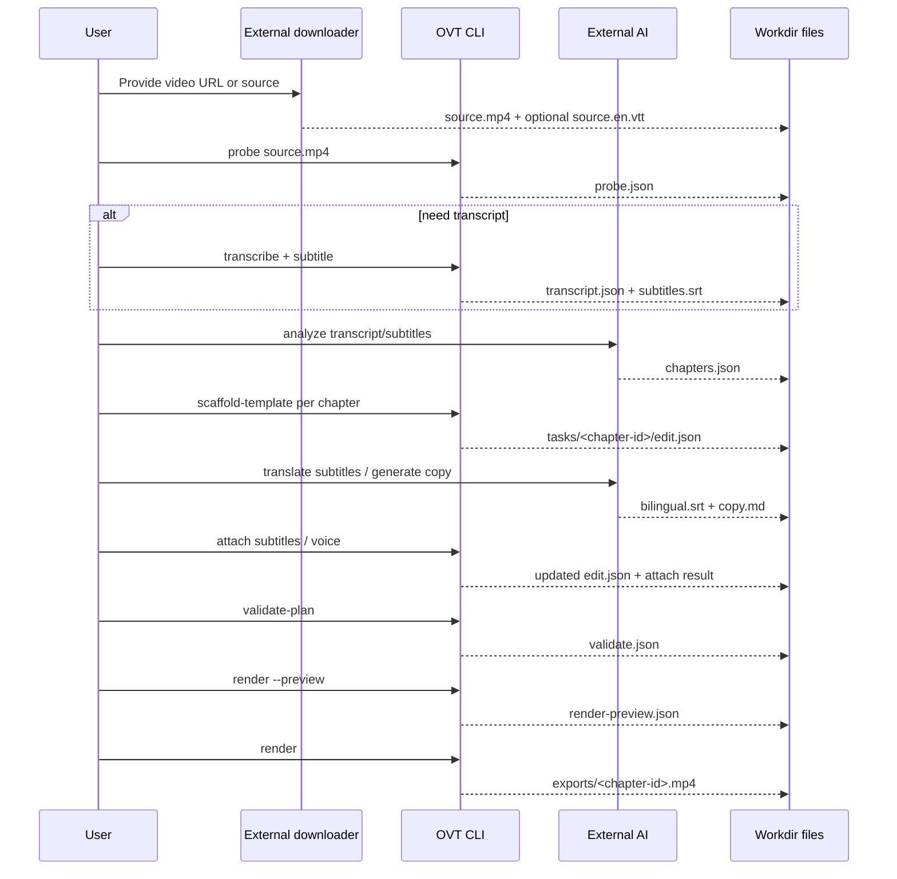

# 外部 AI 视频工作流设计

最后更新：2026-04-29

## 设计目标

把 YouTube Clipper Skill 中有价值的“外部 AI + 确定性媒体处理”模式，整理成 Open Video Toolbox 的标准工作流设计。

本设计不新增运行时代码，只定义后续实现和文档应遵循的协作方式。

## 核心原则

1. OVT 只处理本地文件和结构化输入。
2. 外部 AI 可以生成章节、翻译字幕和文案，但不进入仓库运行时。
3. 所有媒体执行必须通过 OVT CLI / Core owner。
4. 每个阶段都要留下可复查产物。
5. 先 preview，再 render。

## 总体架构

```mermaid
flowchart LR
    Source[外部视频 URL / 本地素材] --> Import[外部下载或用户导入]
    Import --> Local[本地 source.mp4 + 可选 subtitles.vtt]
    Local --> Probe[ovt probe]
    Local --> Text[transcribe 或外部字幕解析]
    Text --> AI[外部 AI 章节/翻译/文案]
    AI --> Artifacts[chapters.json / bilingual.srt / copy.md]
    Artifacts --> Workdir[OVT 工作目录]
    Workdir --> Attach[attach / replace materials]
    Attach --> Validate[validate-plan / inspect-plan]
    Validate --> Preview[render --preview]
    Preview --> Render[render / render-batch]
    Render --> Outputs[clips / final.mp4 / sidecars]
```



## 工作目录约定

推荐目录：

```text
workflows/<job-id>/
├── source/
│   ├── source.mp4
│   └── source.en.vtt
├── signals/
│   ├── probe.json
│   ├── transcript.json
│   ├── subtitles.srt
│   └── chapters.json
├── tasks/
│   └── chapter-02/
│       ├── edit.json
│       ├── inspect.json
│       ├── render-preview.json
│       ├── subtitles.bilingual.srt
│       └── copy.md
├── exports/
│   └── chapter-02.mp4
└── summary.json
```

说明：

- `source/` 保存外部导入结果。
- `signals/` 保存可被 OVT 或外部 AI 复用的结构化信号。
- `tasks/<id>/` 保存每个章节或每个输出任务的独立工作面。
- `exports/` 保存最终可发布产物。
- `summary.json` 用于后续 batch 或人工复核，不要求 OVT 在 L0 阶段自动生成。

当前仓库内已有一个可复制样例：

- `examples/external-ai-video-workflow/README.md`
- `examples/external-ai-video-workflow/signals/chapters.sample.json`
- `examples/external-ai-video-workflow/commands.example.ps1`
- `examples/external-ai-video-workflow/render-batch.sample.json`
- `examples/external-ai-video-workflow/tasks/chapter-02/copy.sample.md`

## 端到端流程

### 阶段 1：外部导入

输入：

- YouTube / 网页视频 URL
- 或已有本地视频

输出：

- `source/source.mp4`
- 可选 `source/source.en.vtt`

边界：

- 下载器不是 OVT 内置能力。
- 用户必须确认有权处理素材。
- 如果使用 `yt-dlp`，它只是外部前置步骤。

示例：

```powershell
yt-dlp -f "bestvideo[height<=1080][ext=mp4]+bestaudio[ext=m4a]/best[height<=1080]" --write-subs --write-auto-subs --sub-langs en --sub-format vtt -o "workflows/job-a/source/source.%(ext)s" "<video-url>"
```

### 阶段 2：探测与文本准备

目标：

- 获取媒体时长、轨道、分辨率
- 准备外部 AI 可读文本

命令：

```powershell
<ovt> probe workflows/job-a/source/source.mp4 --json-out workflows/job-a/signals/probe.json
```

如果需要转写：

```powershell
<ovt> transcribe workflows/job-a/source/source.mp4 --model <whisper-model> --output workflows/job-a/signals/transcript.json --json-out workflows/job-a/signals/transcribe.json
<ovt> subtitle workflows/job-a/source/source.mp4 --transcript workflows/job-a/signals/transcript.json --format srt --output workflows/job-a/signals/subtitles.srt --json-out workflows/job-a/signals/subtitle.json
```

如果已有外部字幕：

- L0：人工或外部工具把 VTT 转为 AI 可读文本或 SRT
- L2 候选：OVT 提供 VTT loader / subtitle clip 命令

### 阶段 3：外部 AI 生成章节

输入：

- `transcript.json`
- 或 `source.en.vtt`
- 或人工整理的带时间戳文本

输出：

- `signals/chapters.json`

推荐结构：

```json
{
  "schemaVersion": 1,
  "source": {
    "input": "../source/source.mp4",
    "text": "transcript.json"
  },
  "chapters": [
    {
      "id": "chapter-02",
      "title": "企业 vs 消费者：战略选择",
      "start": "00:02:40.000",
      "end": "00:04:40.000",
      "summary": "这一段讨论企业市场和消费者市场的战略取舍。",
      "keywords": ["企业", "消费者", "AI 产品"]
    }
  ]
}
```

当前 schema 草案位于：

- `docs/schemas/chapters.schema.json`

约束：

- `id` 必须稳定，可用于目录名和 batch item id。
- `start` / `end` 必须是明确时间，不允许自然语言。
- `summary` 和 `keywords` 只供人和外部 AI 使用，OVT 不依赖它做剪辑决策。

### 阶段 4：生成任务工作目录

L0 可人工按章节执行：

```powershell
<ovt> scaffold-template workflows/job-a/source/source.mp4 --template shorts-captioned --dir workflows/job-a/tasks/chapter-02 --validate --check-files --render-output workflows/job-a/exports/chapter-02.mp4
```

L2/L3 候选可演化为：

```text
ovt scaffold-chapters --input source/source.mp4 --chapters signals/chapters.json --template shorts-captioned --dir tasks
```

生成后必须检查：

```powershell
<ovt> inspect-plan --plan workflows/job-a/tasks/chapter-02/edit.json --check-files --json-out workflows/job-a/tasks/chapter-02/inspect.json
```

### 阶段 5：字幕、翻译和文案接回

外部 AI 可以生成：

- `tasks/chapter-02/subtitles.zh.srt`
- `tasks/chapter-02/subtitles.bilingual.srt`
- `tasks/chapter-02/copy.md`

OVT 只接回需要参与渲染的文件：

```powershell
<ovt> attach-plan-material --plan workflows/job-a/tasks/chapter-02/edit.json --subtitles --path workflows/job-a/tasks/chapter-02/subtitles.bilingual.srt --check-files --json-out workflows/job-a/tasks/chapter-02/attach-subtitles.json
```

如果外部 TTS 或配音已生成：

```powershell
<ovt> bind-voice-track --plan workflows/job-a/tasks/chapter-02/edit.json --path workflows/job-a/tasks/chapter-02/voice.wav --path-style relative --check-files --json-out workflows/job-a/tasks/chapter-02/bind-voice.json
```

### 阶段 6：校验、预览、渲染

```powershell
<ovt> validate-plan --plan workflows/job-a/tasks/chapter-02/edit.json --check-files --json-out workflows/job-a/tasks/chapter-02/validate.json
<ovt> render --plan workflows/job-a/tasks/chapter-02/edit.json --output workflows/job-a/exports/chapter-02.mp4 --preview --json-out workflows/job-a/tasks/chapter-02/render-preview.json
<ovt> render --plan workflows/job-a/tasks/chapter-02/edit.json --output workflows/job-a/exports/chapter-02.mp4
```

规则：

- `validate-plan` 失败时不进入 render。
- `render --preview` 中输出路径或 side effect 不符合预期时不执行。
- 真实执行结果应保留 stdout / `--json-out`。

## 批量流程

当章节数量超过 1 个时，优先使用 batch 思路。

当前可用组合：

1. 外部 AI 生成 `chapters.json`
2. 人工或脚本生成 `scaffold-template-batch` manifest
3. 运行 `scaffold-template-batch`
4. 对每个 task attach 字幕 / voice
5. 生成 `render-batch` manifest
6. 先 `render-batch --preview`
7. 再 `render-batch`

候选章节 batch manifest：

```json
{
  "schemaVersion": 1,
  "items": [
    {
      "id": "chapter-02",
      "input": "source/source.mp4",
      "template": "shorts-captioned",
      "workdir": "tasks/chapter-02",
      "clip": {
        "from": "00:02:40.000",
        "to": "00:04:40.000"
      }
    }
  ]
}
```

注意：

- 上述 `clip` 字段当前只是设计候选，不是已实现 contract。
- 如果要实现，必须复用已有 batch 结果约定：`summary.json`、`results/<id>.json`、退出码 `0/2/1`。

## Mermaid 主流程



## 错误处理设计

| 阶段 | 常见失败 | 处理方式 |
| --- | --- | --- |
| 外部导入 | 下载失败、无字幕、权限不足 | 停在外部步骤；不要生成 OVT plan |
| 探测 | `ffprobe` 不可用、文件损坏 | 跑 `doctor`，修 required 依赖 |
| 转写 | 缺 whisper-cli / model | 跑 `doctor`，或改用外部字幕 |
| 章节生成 | AI 输出时间不合法 | 人工修正 `chapters.json`，后续可由 schema 校验 |
| attach | 字幕/音频路径不存在 | `inspect-plan --check-files` 定位 |
| validate | plan 结构或文件引用错误 | 修 plan 或重新 attach |
| preview | 输出路径或 side effect 不符合预期 | 修 `edit.json` 或命令参数 |
| render | FFmpeg 执行失败 | 保留 execution result 和 stderr |

## 与 workflow skill 的关系

`skills/open-video-toolbox-workflow/SKILL.md` 是给外部 AI agent 的短操作指南。

本文档是更完整的设计背景，供后续实现或维护时判断：

- 为什么不内置下载器
- 为什么不内置 AI provider
- 哪些文件是工作流约定而非 CLI schema
- 哪些能力可以进入后续 Core / CLI 实现

## 后续实现候选

按价值和风险排序：

1. `chapters.json` schema 草案与样例（已开始）
2. `Core.Subtitles` VTT loader
3. 字幕片段提取和双语字幕合成
4. 章节驱动 scaffold / batch 工作目录
5. `doctor` optional libass / yt-dlp 检查
6. 下载器接入边界卡

## 验收口径

本设计完成后，应能回答：

- 外部视频如何进入 OVT
- 外部 AI 的结果以什么文件形式交给 OVT
- 哪些步骤是当前已有命令
- 哪些字段只是候选设计
- 如何避免 AI provider 和 FFmpeg 拼接进入仓库
