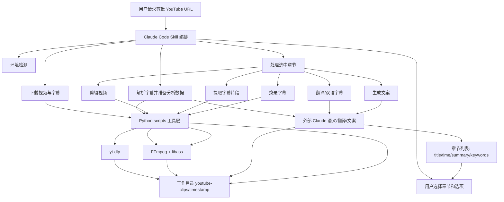
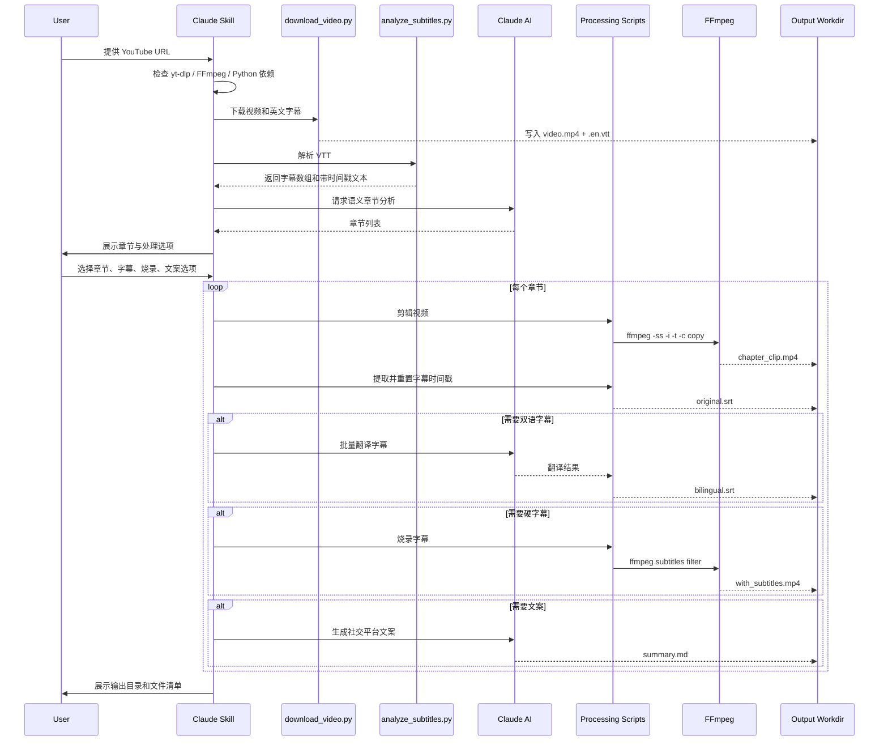
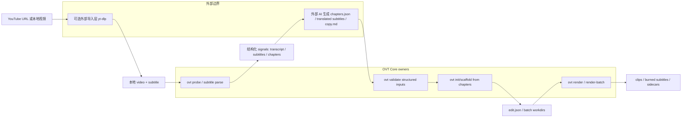

# YouTube Clipper Python 项目解析与融入评估

日期：2026-04-29

## 结论摘要

`youtube/` 目录是一个面向 Claude Code Skill 的 Python 工具包，核心价值不在“完整自动化 Python 应用”，而在“外部 AI 负责语义决策，脚本负责确定性媒体处理”的工作流组合。

它的能力与 Open Video Toolbox 的定位高度相关：下载 YouTube 视频、提取字幕片段、生成双语字幕、烧录字幕、生成社交平台文案，都是个人视频生产链上的高频前置或后置动作。

但不能直接整体并入当前仓库。主要原因是：

- 代码内存在 `subprocess.run(ffmpeg...)`、`yt-dlp`、临时目录、字幕解析等逻辑，当前与 `Core.Execution` / `Core.Subtitles` 的 owner 边界重叠。
- Skill 文档要求 Claude 直接做章节分析、翻译和文案生成；这符合“外部 AI 编排”方向，但不能在仓库内引入 AI provider、SDK 或不可审计黑盒。
- Python 脚本输出多数是人类可读 stdout，缺少 Open Video Toolbox 当前要求的稳定 JSON envelope、`--json-out`、失败结构和 batch contract。

建议路线是“吸收工作流与数据契约，不直接移植脚本实现”：优先把它拆成可审计 CLI 能力和外部 AI orchestration guide，而不是把 `youtube/` 作为运行时子系统塞进产品。

## 项目形态

目录结构：

```text
youtube/
├── SKILL.md
├── README.md / README.zh-CN.md
├── TECHNICAL_NOTES.md
├── FIXES_AND_IMPROVEMENTS.md
├── references/
├── templates/
└── scripts/
    ├── download_video.py
    ├── analyze_subtitles.py
    ├── clip_video.py
    ├── extract_subtitle_clip.py
    ├── translate_subtitles.py
    ├── merge_bilingual_subtitles.py
    ├── burn_subtitles.py
    ├── generate_summary.py
    └── utils.py
```

定位：

- `SKILL.md` 是主入口，定义 Claude Code 的 6 阶段操作流程。
- `scripts/*.py` 是可单独执行的工具脚本，但其中“AI 章节分析 / 翻译 / 文案生成”并不由 Python 代码真实完成，而是通过 stdout 给 Claude 提示，由外部模型补齐结果。
- `references/` 和技术文档沉淀了 yt-dlp、FFmpeg、字幕格式、libass、路径空格等实践经验。

## 功能矩阵

| 功能 | 入口脚本 / 文档 | 输入 | 输出 | 实现方式 | 当前成熟度 | 融入建议 |
| --- | --- | --- | --- | --- | --- | --- |
| 环境检测 | `SKILL.md` | 本机环境 | 可用性提示 | 调用 `yt-dlp --version`、`ffmpeg -filters`、Python import | 文档化流程，非统一命令 | 可映射到 `doctor`，新增可选 `yt-dlp` / `libass` probe |
| YouTube 下载 | `download_video.py` | YouTube URL | mp4、英文 VTT、视频元数据 | `yt_dlp.YoutubeDL`，最高 1080p，输出名用视频 ID | 可用，但非结构化 envelope | 可新增 `download-video` 或 `import-video`；owner 需先决策 |
| 字幕解析 | `analyze_subtitles.py` | VTT | `subtitle_text`、原始字幕数组、总时长 | 正则解析 VTT，清理标签和位置信息 | 可用，但解析较轻量 | 适合沉淀到 `Core.Subtitles` 的 VTT loader |
| 语义章节分析 | `SKILL.md` + 外部 Claude | 带时间戳字幕全文 | 章节标题、时间段、摘要、关键词 | 外部 AI 阅读字幕后生成 | 核心差异化，但非确定性代码 | 不内置 AI；可定义 `chapters.json` schema 与 `init-plan --chapters` 消费 |
| 视频片段剪辑 | `clip_video.py` | 视频路径、起止时间 | clip mp4 | `ffmpeg -ss -i -t -c copy` | 可用 | 已有 `cut` 能力，应复用现有 `Core.Execution` |
| 字幕片段提取 | `clip_video.py` / `extract_subtitle_clip.py` | 完整字幕、起止时间 | clip SRT | 过滤字幕区间并重置时间戳 | 可用，两个实现有重复 | 可沉淀到 `Core.Subtitles`，避免重复实现 |
| 批量翻译字幕 | `translate_subtitles.py` | SRT 字幕 | 双语字幕数据 | 脚本只打印翻译要求；实际由 Claude 翻译 | 半自动 | 不内置翻译 provider；只保留 `translation manifest` / 双语 SRT 合成能力 |
| 双语字幕合并 | `translate_subtitles.py` / `merge_bilingual_subtitles.py` | 英文字幕、中文字幕 | bilingual SRT | SRT 块按序合并，英文在上中文在下 | 可用，两个实现有重复 | 可作为 `subtitle` 子能力扩展，需先定义 schema |
| 字幕烧录 | `burn_subtitles.py` | clip mp4、SRT | burned mp4 | 检测 libass，临时目录避开路径空格，`ffmpeg subtitles` filter | 可用 | 已属于 `Core.Execution` render 范围；应通过 plan/render 接入 |
| 社交文案生成 | `generate_summary.py` | 章节信息 | Markdown 模板 / 文案 | 脚本打印 prompt，外部 Claude 生成 | 半自动 | 不进入 Core；可作为外部 AI guide 或 examples |
| 文件命名与输出目录 | `utils.py` | 标题、base dir | 安全文件名、时间戳目录 | 清理非法字符、当前目录下 `youtube-clips/<timestamp>` | 可用 | 可借鉴为 CLI workdir 约定，但不要建全局 Utils |

## 实现原理

### 1. Skill 编排层

`SKILL.md` 把一次 YouTube 剪辑任务拆成 6 个阶段：

1. 检查 `yt-dlp`、FFmpeg/libass、Python 依赖。
2. 下载视频和英文字幕。
3. 解析字幕，并让 Claude 做语义章节分析。
4. 让用户选择章节和处理选项。
5. 对选中章节执行剪辑、字幕提取、翻译、双语合并、烧录、文案生成。
6. 组织输出目录并展示结果。

这个设计的关键是职责拆分：Python 脚本不尝试理解内容，内容理解和翻译由外部 AI 完成；脚本只负责稳定处理文件。

### 2. 下载层

`download_video.py` 使用 `yt_dlp.YoutubeDL`：

- 校验 YouTube URL。
- 格式选择为最高 1080p，优先 mp4 视频和 m4a 音频。
- 下载英文字幕，人工字幕优先，自动字幕作为备选。
- 输出模板为 `%(id)s.%(ext)s`，避免 YouTube 标题中的空格、引号、冒号造成路径问题。
- 返回 video path、subtitle path、title、duration、file size、video id。

### 3. 字幕数据层

`analyze_subtitles.py` 将 VTT 转成结构化数组：

```json
[
  { "start": 0.0, "end": 3.5, "text": "..." }
]
```

它还生成带时间戳的整段文本供外部 AI 读取。章节分析不是算法切分，而是外部 AI 基于字幕语义决定自然话题边界。

`clip_video.py` 和 `extract_subtitle_clip.py` 都包含字幕片段提取逻辑：按时间区间过滤字幕，并将时间戳减去 clip 起点，使片段字幕从 `00:00:00,000` 开始。

### 4. 媒体执行层

`clip_video.py` 直接调用 FFmpeg：

```text
ffmpeg -ss <start> -i <input> -t <duration> -c copy -y <output>
```

`burn_subtitles.py` 直接调用 FFmpeg 的 `subtitles` filter：

```text
ffmpeg -i video.mp4 -vf subtitles=subtitle.srt:force_style='FontSize=24,MarginV=30' -c:a copy -y output.mp4
```

它额外处理两个实际坑点：

- 检测 FFmpeg 是否支持 `subtitles` filter，也就是 libass 支持。
- 将视频和字幕复制到无空格临时目录再执行 FFmpeg，规避 `subtitles` filter 对路径空格解析不稳定的问题。

### 5. AI 协作层

`translate_subtitles.py` 和 `generate_summary.py` 的实际作用是“准备输入 + 打印 prompt + 生成占位输出”。它们没有调用翻译 API，也没有内置模型 SDK。

这与 Open Video Toolbox 的外部 AI 策略一致，但融入时必须保持为：

- 外部 AI 读取结构化文件。
- 外部 AI 写回结构化文件。
- OVT CLI 只验证、转换、消费这些文件。

## 架构图



## 主流程图



## 与 Open Video Toolbox 的重叠点

| YouTube 项目能力 | OVT 现有 owner / 能力 | 重叠判断 |
| --- | --- | --- |
| FFmpeg 剪辑 | `cut`、`Core.Execution` | 已有能力，不能复制 |
| 字幕烧录 | `render` / subtitle artifact / `Core.Execution` | 可通过 plan/render 表达，不应脚本直调 |
| 字幕 sidecar 生成 | `Core.Subtitles` / `subtitle` | 可扩展 VTT loader 和 clip subtitle 工具 |
| 输出工作目录 | `scaffold-template-batch`、batch artifact helper | 可借鉴，但要沿用现有 batch/workdir 约定 |
| 依赖检测 | `doctor` | 可扩展 yt-dlp/libass 检查 |
| 外部 AI 编排 | README / templates guide / CLI structured files | 理念一致，但不能内置 provider |
| YouTube 下载 | 当前无正式 owner | 需要先做边界决策：是否纳入 OVT |
| 语义章节 JSON | 当前无正式 schema | 可作为新结构化 input，但必须保持外部 AI 写入 |

## 融入可行性评估

### 可行性：中高

适合融入的不是 Python 脚本本身，而是以下产品能力：

- `YouTube URL -> 本地素材 + 字幕` 的导入能力。
- `字幕 -> chapters.json` 的外部 AI 协作契约。
- `chapters.json -> 多 clip edit.json / batch workdir` 的确定性计划生成。
- `clip subtitles -> bilingual subtitles -> render` 的字幕工作流。

这些能力都符合 OVT 当前“CLI + Core + 外部 AI 编排”的方向。

### 主要阻塞

1. **YouTube 下载 owner 未明确**
   - `yt-dlp` 是新外部依赖。
   - 需要决定它是否属于 `Core.Execution` 的外部工具适配，或只作为文档化外部前置步骤。
   - 需要同步 `doctor`、外部依赖文档和 CLI 输出契约。

2. **章节分析不能内置 AI**
   - Python Skill 的最大卖点依赖 Claude 语义分析。
   - OVT 只能定义 `chapters.json` schema、校验命令和消费命令，不能在仓库内调用 Claude/OpenAI/翻译 API。

3. **现有脚本与 owner 边界冲突**
   - 直接并入会绕开 `Core.Execution` 的进程执行、日志、timeout、ProducedPaths 和 overwrite 语义。
   - 也会在字幕解析、时间调整、双语合并处形成第二套 `Core.Subtitles`。

4. **输出契约不符合 OVT 标准**
   - 当前脚本多为 stdout 文案。
   - OVT 需要稳定 JSON envelope、`--json-out`、非零退出码语义、失败上下文和命令快照测试。

5. **版权与平台边界需要产品决策**
   - YouTube 下载能力涉及平台条款、版权和区域差异。
   - 至少需要文档明确“用户自担权限、仅处理有权处理的内容”，并考虑是否默认不下载、只支持本地文件 + 外部 yt-dlp 产物。

## 推荐落地路线

### L0：保留为外部参考，不进运行时

短期最安全路线：

- 把 `youtube/` 作为外部能力调研样本。
- 不把 Python 作为 OVT runtime。
- 产出 OVT 风格的 YouTube 工作流 guide：外部 `yt-dlp` 下载 -> OVT `probe/transcribe/subtitle/init-plan/render`。

收益低，但风险最低。

### L1：定义结构化契约，先不接 yt-dlp

建议优先做：

- 新增 `chapters.json` 评估文档或 schema 草案。
- 新增或扩展命令：从章节清单生成 `edit.json` / batch workdir。
- 复用现有 `cut` / `render` / `subtitle` / `attach-plan-material`。

这能吸收 Skill 的“语义章节 -> 可批量剪辑”核心价值，同时不新增下载依赖。

候选命令形态：

```text
ovt init-plan-from-chapters --input video.mp4 --chapters chapters.json --dir ./tasks
```

或作为现有模板/批量能力的扩展，不急于新增命令。

### L2：接入 VTT 与双语字幕确定性能力

可沉淀到 `Core.Subtitles`：

- VTT loader。
- subtitle clip extraction。
- bilingual SRT merge。

CLI 层只做薄入口或接入 `subtitle` / `attach-plan-material` 现有命令族。

### L3：评估 `yt-dlp` 导入命令

只有在产品边界明确后再做：

- `doctor` 增加 optional `yt-dlp` 检查。
- `Core.Execution` 增加 `yt-dlp` 外部工具执行模型。
- CLI 新增稳定 envelope 的下载/import 命令。
- 文档明确平台、版权、失败重试和输出目录约定。

这一步会引入新外部工具 owner 和更高维护成本，应单独开边界卡。

## 不建议直接照搬的部分

- 不建议保留 Python 脚本里的 FFmpeg 直调。
- 不建议在 OVT 内实现 Claude 翻译、章节分析或文案生成。
- 不建议新增全局 `Utils` 来搬运 `utils.py`。
- 不建议让 Desktop 或 CLI 直接处理字幕烧录细节。
- 不建议把 Skill 的交互式用户选择流程做成 Core 逻辑。

## 推荐 OVT 目标架构



## 文档同步判断

本轮只新增评估文档：

- 当前优先级：未改变。
- owner / 模块边界：未改变。
- 外部使用方式、验收标准或阶段门槛：未改变。

若后续决定进入 L1/L2/L3，需要至少同步：

- `docs/roadmap.md`
- `docs/ARCHITECTURE_GUARDRAILS.md`
- 对应 `MODULE.md`
- `docs/external-dependencies.md`
- `README.md` / `docs/COMMAND_REFERENCE.md`

